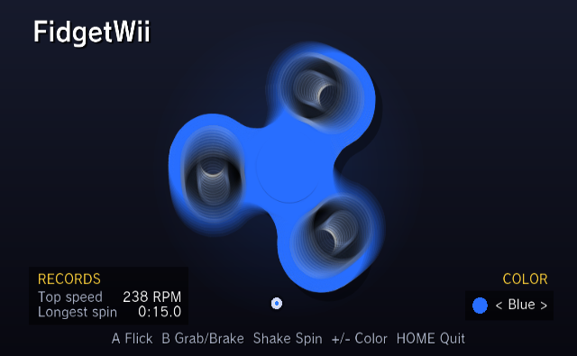

# FidgetWii

A fidget spinner for the Wii. Flick it, grab it with the Wii Remote pointer,
shake it faster, change its color, and try to beat your records.

## Controls

| Action | Wii Remote | GameCube | Classic Controller | Keyboard |
| --- | --- | --- | --- | --- |
| Flick clockwise | A | A | A | Enter / Space |
| Flick counterclockwise | 1 | Y | Y | X |
| Grab and spin by hand | Point at the spinner, hold B and move | | | |
| Brake | Hold B | Hold B | Hold B | Backspace |
| Spin faster | Shake the remote, or rotate the Nunchuk stick | Rotate the control stick | Rotate the left stick | |
| Change color | Left/Right or +/- | Left/Right or L/R | Left/Right or +/- | Arrows or -/= |
| Sound on/off | Up | Up | Up | Up |
| Show/hide help | Down | Down | Down | Down |
| Reset records | 2 (press twice) | X (twice) | X (twice) | Y (twice) |
| Exit | HOME | Start | HOME | Esc |

Colors: Yellow, Red, Orange, Lime, Green, Cyan, Blue, Purple, Pink, White,
Black, Gold and Rainbow.

## Records

FidgetWii shows your top speed (RPM) and your longest spin (time spent
coasting after the last push), and also tracks your lifetime number of spins.
They are saved, along
with your color choice, to `sd:/apps/FidgetWii/record.txt` when the spinner
stops and when you exit.

## Installing

Copy the `apps/FidgetWii` folder to the root of your SD card and put
`FidgetWii.dol` in it as `boot.dol`, then launch it from the Homebrew Channel.

## Building

Needs devkitPPC and libogc.

    make

To also support the Wii U GamePad (Wii U VC with a patched fw.img), Wii U Pro
Controller and wired DualShock 3:

    ./scripts/build_controller_portlibs.sh
    make WITH_WIIDRC=1 WITH_WUPC=1 WITH_SICKSAXIS=1

The spinner textures in `data/` are generated from `assets/spinner.png` with
`python3 scripts/make_textures.py` (needs Pillow). The script splits the photo
into a plastic layer, which is tinted at runtime, and an untinted bearing layer.

The HUD font is FOT-Rodin NTLG Pro, pre-rendered into glyph atlases
(`data/font_*.bin` and `source/font_data.h`). The font files themselves are not
included; to regenerate the atlases, run:

    python3 scripts/make_font.py FOT-RodinNTLGPro-DB.otf FOT-RodinNTLGPro-B.otf

## Credits

- Controller input code from GlowWii.
- Spinner photo: [Yellow Fidget Spinner](https://commons.wikimedia.org/wiki/File:Yellow_Fidget_Spinner.png)
  by Daserino, licensed [CC BY-SA 4.0](https://creativecommons.org/licenses/by-sa/4.0/).
  The textures in `data/` and the icon are derived from it and are under the same license.
